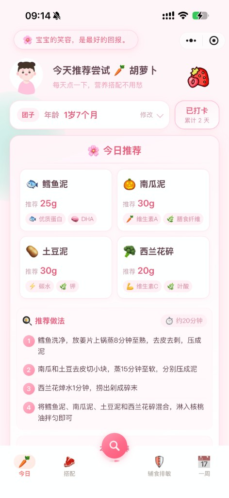
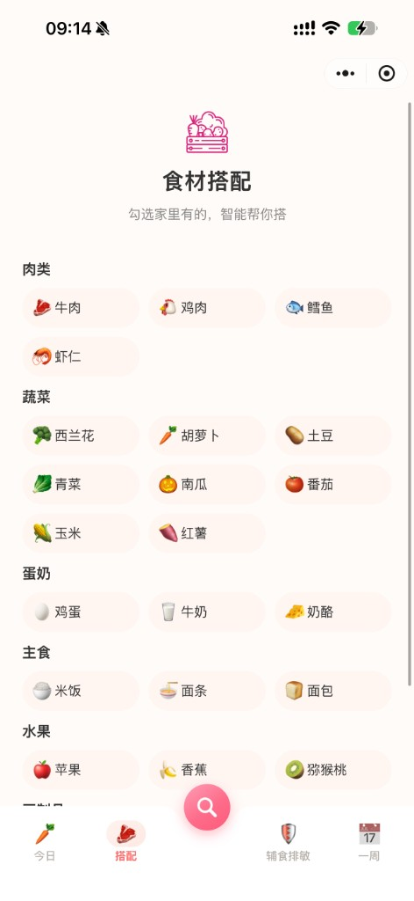
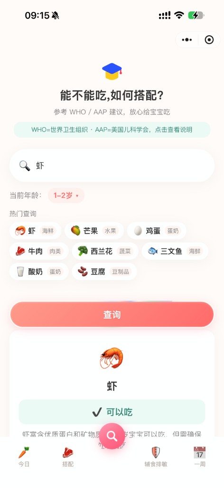
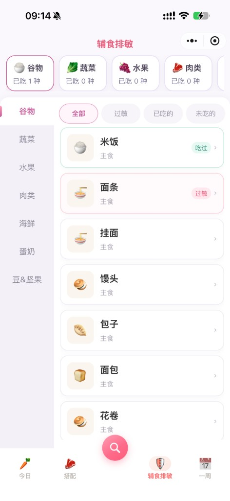

<div align="center">


# 团子食光 · 宝宝辅食小助手

**结合 AI 的婴幼儿辅食推荐微信小程序 —— 照着买、照着做，营养搭配不用愁**

</div>

---

## 📖 简介

「团子食光」面向 **6 个月至 7 岁** 宝宝家长。填写小名、性别和出生日期后，会自动换算当前月龄，再按该月龄的质地、调味与安全要求，生成每日推荐、食材搭配、一周菜单，并解答「能不能吃」「过敏会有什么症状」。

- 🎂 **生日驱动月龄**：选一次出生日期，所有推荐都按真实月龄计算
- 🤖 **AI 营养师**：接入 DeepSeek，参考 WHO / AAP 辅食建议
- 🍡 **每日 10 次额度**：超限弹出「团子累趴了」，已生成内容会保留
- ☁️ **云端同步**：档案、过敏原、打卡记录走微信云开发
- 🎀 **粉色可爱风**：自定义导航 + 底部五栏，中间是「能不能吃」入口

---

## 🗺️ 产品大纲

底部导航共 5 个入口，对应 5 个页面：

```
团子食光
├── 🥕 今日（首页）
│   ├── 档案：性别 / 小名 / 出生日期 → 自动显示「X岁X个月」
│   ├── 每日一句建议（按月龄推荐今天可尝试的食材）
│   ├── 打卡（累计天数 + 撒花）
│   └── 🌸 今日推荐
│       ├── 4 种食材：克重 + 营养标签
│       ├── 推荐做法 + 预计耗时
│       ├── 本餐营养环 + 调料用量
│       └── 预计价格 / 温馨提示 / 换一组
│
├── 🥩 搭配
│   ├── 分类勾选：肉类 / 蔬菜 / 蛋奶 / 主食 / 水果 / 豆制品
│   ├── 自定义输入家里有的菜名
│   └── 智能搭配：主配菜、热量、调料、做法、搭配理由
│
├── 🔍 能不能吃（中心按钮）
│   ├── 搜索食材 + 热门查询
│   ├── 结论：可以吃 / 不建议 / 谨慎尝试
│   ├── 喂养评估雷达图
│   └── WHO / AAP 建议、搭配食材、调料、做法、注意事项
│
├── 🛡️ 辅食排敏
│   ├── 分类进度条：谷物 / 蔬菜 / 水果 / 肉类 / 海鲜 / 蛋奶 / 豆&坚果
│   ├── 筛选：全部 / 过敏 / 已吃的 / 未吃的
│   └── 食材详情：吃过、过敏、AI 查症状
│
└── 📅 一周
    ├── 生成 7 天菜单（早 / 中 / 晚）
    ├── 一周营养分析：分类占比饼图 + 每日评分柱状图
    ├── 营养亮点
    └── 分类采购清单
```

年龄档（由出生日期自动匹配，供推荐与本地兜底使用）：

`6-8个月` → `8-10个月` → `10-12个月` → `1-2岁` → `2-3岁` → `4-5岁` → `6-7岁`

---

## 🖼️ 预览

| 今日推荐 | 食材搭配 | 能不能吃 | 辅食排敏 |
| :---: | :---: | :---: | :---: |
|  |  |  |  |

---

## ✨ 页面说明

### 🥕 今日 · `pages/index`

首次进入先选男宝 / 女宝，并填写小名。点击年龄卡片选择出生日期后，展示换算后的年龄（如「1岁7个月」）。

| 模块 | 内容 |
| --- | --- |
| 顶部建议 | 按月龄生成一句「今天推荐尝试 XX」 |
| 打卡 | 每日一次，显示累计天数 |
| 今日推荐 | AI 出 4 种食材，含推荐克重、营养标签、分步做法、预计做饭时间、营养占比、调料克数/勺数、食材价格 |
| 换一组 | 重新生成；额度用尽只弹窗，不清除当前结果 |

> 「随机一天菜单」目前在首页注释隐藏，代码仍保留，需要时可恢复。

### 🥩 搭配 · `pages/combine`

勾选家里现有食材（也可自己输入菜名），至少 2 种后点「智能搭配」。

结果包含：主菜 / 配菜方案、大约热量、调料用量、做法步骤、「为什么这么搭」。过敏食材会在推荐中自动排除。

### 🔍 能不能吃 · `pages/can-eat`

输入食材或点热门标签查询，结论分三种：**可以吃 / 不建议 / 谨慎尝试**。

下方依次是喂养评估雷达图、WHO 与 AAP 权威建议、可搭配食材、调料、推荐做法、不建议事项。热门标签会按当前月龄更新。

### 🛡️ 辅食排敏 · `pages/desensitize`

左侧分类、顶部进度卡片、右侧食材列表。点开食材可标记「吃过」「过敏」（过敏会同步到今日推荐和搭配排除）。

「AI 查症状」会给出常见表现、关注程度、紧急就医信号和观察建议，仅供排敏参考。

### 📅 一周 · `pages/weekly`

一键生成 7 天菜单，每天含早 / 中 / 晚。下方有食材分类占比、每日营养评分、营养亮点和按类分组的采购清单。

> 导出到相册的入口目前注释隐藏。

---

## 🛠️ 技术栈

| 分类 | 说明 |
| --- | --- |
| 框架 | 微信小程序原生（Skyline / glass-easel；图表页使用 Webview） |
| AI | [DeepSeek](https://www.deepseek.com/) Chat API，统一走 `utils/ai.js` |
| 限流 | `utils/aiQuota.js`，本地按自然日计数，每天 10 次 |
| 云能力 | 微信云开发，档案集合 `babies` |
| 图表 | ECharts（`ec-canvas`：雷达图 / 饼图 / 柱状图） |
| 存储 | 本地缓存 + 云端同步；AI 结果按日缓存 |

---

## 📂 目录结构

```
babyEatingToday/
├── app.js / app.json / app.wxss
├── config/                          # 需自行复制示例后填写
│   ├── ai-secret.example.js
│   └── cloud.example.js
├── pages/
│   ├── index/                       # 今日
│   ├── combine/                     # 食材搭配
│   ├── can-eat/                     # 能不能吃
│   ├── desensitize/                 # 辅食排敏
│   └── weekly/                      # 一周菜单
├── components/
│   ├── tab-bar/                     # 底部五栏导航
│   ├── navigation-bar/
│   ├── beam-button/
│   └── ec-canvas/
├── utils/
│   ├── ai.js                        # 全部 AI 提示词
│   ├── aiQuota.js                   # 每日 10 次额度
│   ├── foodData.js                  # 月龄换算、年龄档、本地食谱兜底
│   ├── nutritionHelper.js
│   ├── storage.js / cloudProfile.js
│   └── ...
└── docs/screenshots/
```

---

## 🚀 快速开始

### 1. 环境准备

- [微信开发者工具](https://developers.weixin.qq.com/miniprogram/dev/devtools/download.html)
- 微信小程序 AppID
- [DeepSeek API Key](https://platform.deepseek.com/)

### 2. 配置密钥

```bash
cp config/ai-secret.example.js config/ai-secret.js
cp config/cloud.example.js config/cloud.js
```

`config/ai-secret.js`：

```js
module.exports = {
  apiKey: 'sk-你的DeepSeekKey',
  baseUrl: 'https://api.deepseek.com',
  model: 'deepseek-chat',
}
```

`config/cloud.js`：

```js
module.exports = {
  ENV_ID: '你的云开发环境ID',
  PROFILE_COLLECTION: 'babies',
}
```

### 3. 开通云开发

在开发者工具开通云开发，创建数据库集合 `babies`。

### 4. 运行

用微信开发者工具打开项目根目录，编译预览即可。

> `config/ai-secret.js` 与 `config/cloud.js` 含密钥，请勿提交到公开仓库。

---

## 🔑 AI 说明

所有请求经 `callAI` 发出，并注入 `buildBabyContext`：

```
昵称、性别、当前月龄（由出生日期换算）、年龄档、过敏原、不吃的食材、该月龄调味与质地
```

| 能力 | 使用页面 |
| --- | --- |
| `todayRecommend` / `todaySuggestion` | 今日 |
| `smartCombine` | 搭配 |
| `canEatQuery` / `canEatHotTags` | 能不能吃 |
| `allergySymptomsQuery` | 辅食排敏 |
| `weeklyMenu` | 一周 |

每天最多 **10 次**。额度用尽会提示「团子累趴了 🍡」，已有结果不会被清空。Key 未配置或调用失败时，回退到本地食谱 / 规则。

`randomDayMenu`（随机一天菜单）代码仍在，首页入口已隐藏。

---

## ⚠️ 免责声明

本小程序的推荐仅作辅食搭配**参考**，依据 WHO / AAP 通用建议生成，**不能替代医生或专业营养师意见**。过敏、疾病及特殊喂养问题，请咨询专业医疗人员。

---

<div align="center">

Made with 💗 for every little 团子

</div>
